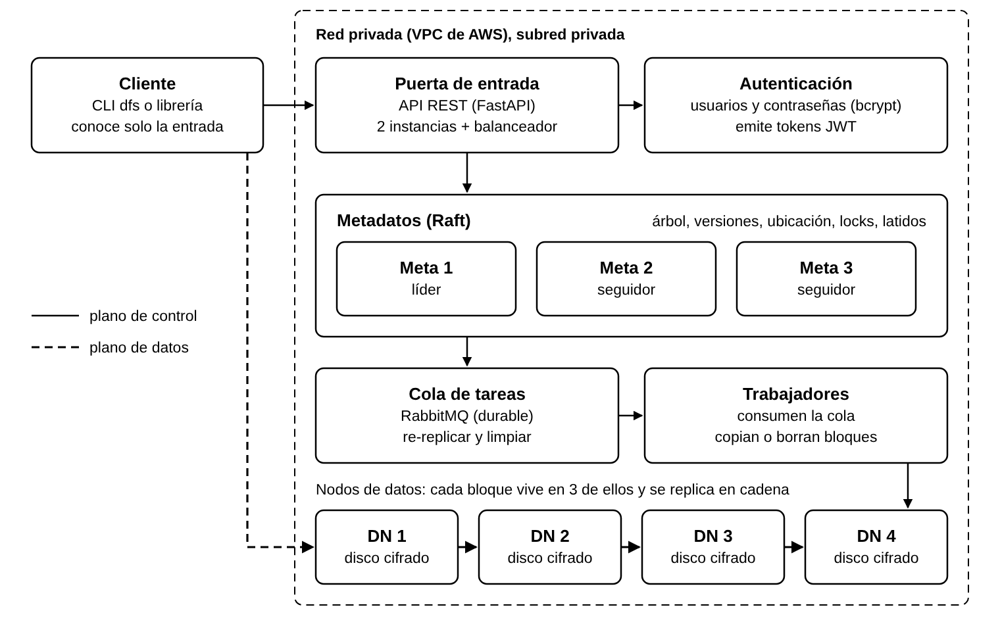
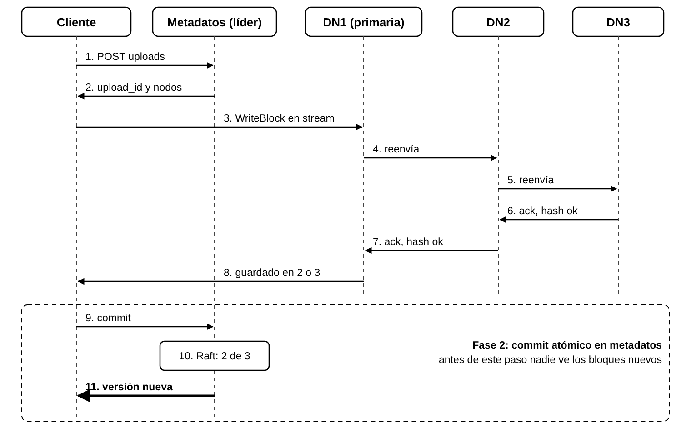

# DFSha · Sistema de archivos distribuido con alta disponibilidad, rendimiento y seguridad

**Proyecto 1 – Fase II (implementación grupal)** · Arquitecturas de Nube y Sistemas Distribuidos · UPB 2026-2 · Prof. Álvaro Ospina

Implementación de la **Opción 1: cliente/servidor con servicio distribuido entre servidores (S2S)**,
siguiendo el diseño individual de la Fase I de **Andrey Murillo Osorio** ("DFSha – Fase I: diseño
individual", 27 de octubre de 2026). Todo corre en contenedores Docker sobre EC2 con
**Ubuntu Server 26.04 LTS** dentro de una VPC de AWS con subred privada.

> Las diferencias con el diseño (pocas, y todas justificadas) están en
> [`docs/DECISIONES.md`](docs/DECISIONES.md), junto con la tabla que ubica cada decisión del
> diseño en el código.

## Contenido

1. [Arquitectura](#1-arquitectura)
2. [Estructura del repositorio](#2-estructura-del-repositorio)
3. [Garantías y semántica declarada](#3-garantías-y-semántica-declarada)
4. [API REST y CLI](#4-api-rest-y-cli)
5. [Despliegue en AWS paso a paso](#5-despliegue-en-aws-paso-a-paso-comando-a-comando)
6. [Pruebas exigidas en la Fase II](#6-pruebas-exigidas-en-la-fase-ii-sección-52)
7. [Ejecución local (desarrollo)](#7-ejecución-local-desarrollo)
8. [Operación y solución de problemas](#8-operación-y-solución-de-problemas)
9. [Contribuciones](#9-contribuciones)

---

## 1. Arquitectura



*Figura 1 del diseño: el plano de control (línea continua) va del cliente a la puerta y a
metadatos; el plano de datos (línea punteada) va directo del cliente a los nodos de datos.*

Cada archivo se parte en **bloques de 8 MiB**; cada bloque se guarda en **3 nodos de datos
distintos** con **replicación en cadena**. Un **servicio de metadatos replicado con Raft
(3 nodos)** sabe qué bloques forman cada versión de cada archivo y dónde está cada bloque.
Una escritura solo se vuelve visible cuando **al menos 2 réplicas** guardaron y verificaron
cada bloque **y** metadatos registró la nueva versión en el log de Raft.

### Componentes

| Componente | Responsabilidad | Instancias | Código | Puerto |
|---|---|---|---|---|
| Cliente (`dfs` / librería) | Partir y unir archivos, SHA-256, hablar con la puerta y con los nodos | 1 por usuario | `src/dfsha/client` | — |
| Puerta de entrada | API REST (FastAPI) sin estado; valida el JWT y envía cada operación al líder de metadatos | 2 + NLB interno | `src/dfsha/gateway` | 8443 (NLB: 443) |
| Autenticación | Contraseñas con bcrypt, emisión de JWT RS256 de 15 min | 1 (ctrl1) | `src/dfsha/auth` | 8500 |
| Metadatos | Árbol, manifiestos y versiones, ubicación de réplicas, locks, estado de nodos (Raft) | 3 (1 líder) | `src/dfsha/metadata` | 7100 |
| Nodos de datos | Bloques cifrados (AES-256-GCM), verificación SHA-256, cadena de réplicas, latidos | 4 | `src/dfsha/datanode` | 7001 / 7002 |
| Cola de tareas | RabbitMQ durable (re-replicar y limpiar) | 1 (ctrl3) | imagen `rabbitmq:4.1` | 5671 (TLS) |
| Trabajadores | Consumen la cola, copian o borran bloques, ACK manual | 2 (ctrl3) | `src/dfsha/worker` | — |

### Comunicación (todo cifrado)

| Canal | Protocolo | Seguridad |
|---|---|---|
| Cliente → puerta (`https://dfs.internal`) | REST/JSON sobre HTTPS | TLS (1.3 negociado), JWT |
| Cliente → nodo de datos (7001) | gRPC streaming, trozos de 1 MiB | TLS + token de bloque HMAC |
| Nodo ↔ nodo (7002) | gRPC streaming (cadena de réplicas) | **TLS mutuo** + token |
| Puerta / auth / trabajadores / nodos → metadatos (7100) | gRPC | **TLS mutuo** (rol según el CN del certificado) |
| Metadatos ↔ metadatos (7100) | Raft sobre gRPC (con PreVote) | **TLS mutuo** |
| Puerta → auth (8500) | HTTPS | **TLS mutuo** |
| Líder y trabajadores → RabbitMQ (5671) | AMQP 0-9-1 | **TLS mutuo** + usuario/contraseña |

### Despliegue en AWS (8 instancias, 1 zona)

| Máquina | IP privada | Tipo | Contenedores | Grupo de seguridad |
|---|---|---|---|---|
| cliente / bastión | 10.20.1.10 (+ IP pública) | t3.small | CLI `dfs` | `dfsha-client` |
| ctrl1 | 10.20.2.11 | t3.medium | `dfsha-meta` (meta1), `dfsha-gateway` (gateway1), `dfsha-auth` | `dfsha-ctrl` |
| ctrl2 | 10.20.2.12 | t3.medium | `dfsha-meta` (meta2), `dfsha-gateway` (gateway2) | `dfsha-ctrl` |
| ctrl3 | 10.20.2.13 | t3.medium | `dfsha-meta` (meta3), `dfsha-rabbitmq`, `dfsha-worker1`, `dfsha-worker2` | `dfsha-ctrl` |
| dn1 … dn4 | 10.20.2.21 … 24 | t3.small | `dfsha-datanode` | `dfsha-data` |
| NLB interno | 10.20.2.100 (`dfs.internal`) | — | reenvía 443 → ctrl1/ctrl2:8443 | `dfsha-nlb` |

```
                 Internet
                    │ SSH (solo desde MY_IP)
   ┌────────────────┼──────────────── VPC 10.20.0.0/16 ─────────────────────────────┐
   │  subred pública 10.20.1.0/24     │                                             │
   │   [cliente/bastión]   [NAT GW] ──┘ (salida para apt, Docker Hub, PyPI, GitHub) │
   │        │  https://dfs.internal:443          gRPC 7001                          │
   │  ──────┼────────────────────────────────────────┼──────────────────────────── │
   │  subred privada 10.20.2.0/24 (sin IP pública)   │                              │
   │   [NLB 10.20.2.100] ─► ctrl1:8443, ctrl2:8443    ▼                              │
   │   ctrl1: meta1 gw1 auth    ctrl2: meta2 gw2    dn1  dn2  dn3  dn4               │
   │   ctrl3: meta3 rabbitmq worker1 worker2         (7002 TLS mutuo entre ellos)    │
   └────────────────────────────────────────────────────────────────────────────────┘
```

### Flujo de una escritura (Figura 3 del diseño)



1. `POST /v1/files/uploads` → metadatos elige 3 nodos por bloque (vivos, más espacio, menos
   carga, primaria rotativa) y devuelve `upload_id`, la cadena y un **token firmado** por bloque.
2. El cliente envía cada bloque (en paralelo) al primer nodo en trozos de 1 MiB; ese nodo lo
   cifra, lo guarda en un temporal y **lo reenvía mientras lo recibe** al siguiente.
3. Cada nodo verifica el SHA-256, **renombra** el temporal (atómico) y firma un **recibo**.
4. `POST /v1/files/uploads/{id}/commit` con los recibos: metadatos exige ≥ 2 recibos válidos
   por bloque y registra la nueva versión en **una sola entrada del log de Raft**.

---

## 2. Estructura del repositorio

```
dfsha/
├── README.md                     este documento
├── docs/
│   ├── DECISIONES.md             diseño → código y cambios justificados
│   └── img/                      figuras del diseño de la Fase I
├── proto/dfsha.proto             contratos gRPC (DataNode y Metadata/Raft)
├── src/dfsha/
│   ├── common/                   configuración, TLS, tokens HMAC, AES-GCM, auditoría, cliente de metadatos, RabbitMQ
│   ├── metadata/                 raft.py (Raft + PreVote + snapshots), state_machine.py, service.py, placement.py, storage.py
│   ├── datanode/                 store.py (bloques cifrados, escritura atómica), service.py (cadena), main.py (latidos, scrubber)
│   ├── gateway/                  API REST (FastAPI)
│   ├── auth/                     inicio de sesión (bcrypt + JWT RS256) y herramienta de administración
│   ├── worker/                   trabajador de re-replicación y limpieza
│   ├── client/                   librería (DFSClient, DFSFile) y CLI `dfs`
│   └── proto/                    código generado por grpc_tools
├── docker/Dockerfile             imagen única dfsha:2.0 (usuario sin privilegios)
├── deploy/
│   ├── aws/                      00-variables … 05-distribuir, 99-limpieza (AWS CLI)
│   ├── compose/docker-compose.yml   servicios por máquina (perfiles ctrl1, ctrl2, ctrl3, data)
│   ├── inventory/                IPs/nombres: aws.env, local.env, docker-local.env
│   └── rabbitmq/                 plantilla de configuración (solo TLS mutuo)
├── scripts/
│   ├── gen-certs.sh              CA interna, certificados, llaves JWT y secretos → paquetes por máquina
│   ├── node-setup.sh             prepara una EC2 (Docker, reloj, certificados) y levanta su rol
│   ├── meta-status.py            estado de Raft y huella del estado de cada réplica
│   ├── run-local.sh              clúster completo como procesos en una máquina
│   └── local-rabbitmq.sh         RabbitMQ local con TLS
├── tests/                        01…07 (pruebas de la sección 5.2), bench.py, rf3_check.py, unit/
├── .github/workflows/ci.yml      compilación, pruebas unitarias y shellcheck en cada push
├── docker-compose.local.yml      clúster en un portátil con Docker
├── pyproject.toml / requirements.txt
```

---

## 3. Garantías y semántica declarada

| Garantía (formulada de forma comprobable) | Mecanismo | Prueba |
|---|---|---|
| Una escritura está **confirmada** cuando el commit responde 200; desde ahí todo `open`/`ls` ve esa versión o una posterior | Commit = una entrada del log de Raft (mayoría 2 de 3); lecturas en el líder con lease de lectura | 05-C |
| Una lectura nunca mezcla versiones | Bloques inmutables; el manifiesto cambia completo | 05-C, 02 |
| Cada bloque confirmado está en ≥ 2 nodos | Recibos firmados de cada nodo; W = 2 de N = 3 | 04, 05-A |
| Dos escritores no se pisan | Lock exclusivo con lease y **token de cercado** + commit condicionado al `block_id` esperado | 03 |
| Un archivo nunca se publica incompleto | Temporal + renombrado atómico + commit que exige hash y 2 recibos | 04-E |
| El cliente no conoce direcciones de nodos | Solo usa `dfs.internal`; ubicación por manifiesto en cada operación | 01 |
| Ante partición, el lado sin mayoría rechaza (CP) | `503 NO_QUORUM` | 04-F |

**RF3 (`write()`):** creación, reemplazo completo (`w`), anexado (`a`) y modificación parcial por
bloque (`rw`), con copia en escritura. Visibilidad **close-to-open**. `lock()` explícito sobre
rangos de bloques (compartido/exclusivo, espera con cola FIFO, lease de 30 s). Detalle en
[`docs/DECISIONES.md`](docs/DECISIONES.md#3-semántica-declarada-rf3).

---

## 4. API REST y CLI

Todas las rutas, salvo el inicio de sesión, exigen `Authorization: Bearer <JWT>`.

| Método y ruta | Uso | Respuesta |
|---|---|---|
| `POST /v1/auth/login` | Iniciar sesión | 200 `{token, expires_in}` |
| `GET /v1/fs/ls?path=` · `GET /v1/fs/stat?path=` | Listar · detalles (bloques, réplicas, locks) | 200 |
| `POST /v1/fs/mkdir` · `DELETE /v1/fs/rmdir?path=` | Crear · borrar directorio vacío | 201 · 204 |
| `DELETE /v1/fs/files?path=` · `POST /v1/fs/mv` | Borrar archivo · mover/renombrar | 204 · 200 |
| `GET /v1/files/manifest?path=[&version=]` | Bloques, réplicas vivas y tokens de lectura | 200 |
| `POST /v1/files/uploads` | Iniciar escritura (`create`, `replace`, `append`, `modify`) | 201 `{upload_id, blocks[]}` |
| `POST /v1/files/uploads/{id}/blocks/{i}/replace` | Pedir nodos de reemplazo para un bloque | 200 |
| `POST /v1/files/uploads/{id}/commit` · `DELETE /v1/files/uploads/{id}` | Confirmar · cancelar | 200 · 204 |
| `POST /v1/locks` · `PUT /v1/locks/{id}` · `DELETE /v1/locks/{id}` | Pedir · renovar · soltar lock | 201 · 200 · 204 |
| `GET /v1/admin/cluster` | Estado del clúster (rol admin) | 200 |

Códigos de error del Anexo A.4: `400 INVALID_PATH`, `401 TOKEN_EXPIRED`, `403 FORBIDDEN`,
`404 NOT_FOUND`, `409 VERSION_CONFLICT | DIR_NOT_EMPTY | FENCED`, `410 VERSION_GONE`,
`422 INCOMPLETE_UPLOAD`, `423 LOCKED`, `503 NO_QUORUM`, `507 NO_SPACE`; en gRPC
`DATA_LOSS`, `UNAVAILABLE`, `PERMISSION_DENIED`.

Ejemplo con `curl` desde el cliente:

```bash
CA=~/.dfsha/ca.crt
TOKEN=$(curl -s --cacert $CA https://dfs.internal/v1/auth/login -H 'content-type: application/json' \
  -d '{"username":"andrey","password":"<clave>"}' | python3 -c 'import json,sys; print(json.load(sys.stdin)["token"])')
curl -s --cacert $CA -H "Authorization: Bearer $TOKEN" "https://dfs.internal/v1/fs/ls?path=/home/andrey"
```

CLI `dfs` (RF1, RF2, RF3):

```bash
dfs login -u andrey                         # pide la contraseña
dfs pwd | dfs cd docs | dfs ls | dfs mkdir -p a/b | dfs rmdir a/b | dfs rm x | dfs mv x y
dfs stat --blocks video.mp4                 # bloques, réplicas y locks
dfs put video.mp4 [/home/andrey/video.mp4] [--block-size 1] [--replication 3] [-v]   # send()
dfs get video.mp4 copia.mp4                 # recv() + verificación SHA-256
dfs cat notas.txt --offset 100 --length 50  # read(offset, n)
dfs write notas.txt --offset 10 --data "hola" [--wait 30] [--no-lock]                 # write() rw
dfs write notas.txt --mode w --data "todo nuevo"                                      # write() w
dfs append notas.txt --data "fin"           # write() a
dfs truncate notas.txt 100
dfs lock notas.txt --blocks 3-3 --hold 20   # lock() explícito
dfs shell                                   # modo interactivo (cd persiste)
dfs admin status                            # solo rol admin
```

Librería:

```python
from dfsha.client.api import DFSClient
c = DFSClient.from_session()
with c.open("/home/andrey/notas.txt", "rw", lock_wait=10) as f:   # open()
    f.lock(0, 0, "exclusive")                                      # lock()
    f.write(5, b"hola")                                            # write()
    print(f.read(0, 20))                                           # read() (ve sus cambios)
# close() confirma de forma atómica y suelta los locks
```

---

## 5. Despliegue en AWS paso a paso (comando a comando)

> **Entorno:** AWS Academy Learner Lab (región `us-east-1`, par de llaves `vockey`,
> perfil `LabInstanceProfile`, máximo 9 instancias: aquí se usan 8). Sirve igual en una cuenta
> normal de AWS cambiando `KEY_NAME` e `INSTANCE_PROFILE`.
> **Sistema operativo:** Ubuntu Server **26.04 LTS** (Resolute Raccoon, publicada en abril de
> 2026), la última LTS disponible en 2026; la AMI se toma del parámetro público de Canonical
> en SSM.

### 5.1 Repositorio en GitHub

El repositorio se arma con los commits de cada integrante, en tres partes (ver
[Contribuciones](#9-contribuciones)). Antes de desplegar, confirme que `main` tiene las tres
partes:

```bash
git clone https://github.com/<usuario>/dfsha.git && cd dfsha
git log --format='%h %an  %s' | cat      # commits de Andrey, Diego y Mateo
git shortlog -sn HEAD                     # número de commits por integrante
```

> Si el repositorio es **privado**, los nodos necesitan un token para clonarlo
> (`https://<token>@github.com/<usuario>/dfsha.git`). Lo más simple para el curso es dejarlo
> **público** (no contiene secretos: los certificados y claves se generan después y están en
> `.gitignore`).

### 5.2 Crear la red, la seguridad, las instancias y el balanceador

En el Learner Lab: **Start Lab** → cuando el indicador esté en verde, abra **AWS Details →
Download PEM** (guarde `labsuser.pem`) y use la terminal del laboratorio (o **AWS CloudShell**).

```bash
# 1) Clonar el repositorio en la terminal del laboratorio
git clone https://github.com/<usuario>/dfsha.git
cd dfsha

# 2) IP desde la que hará SSH al bastión. Si entrará desde su portátil, use la IP de su
#    portátil (ábrala en el navegador: https://checkip.amazonaws.com) en vez de la de la terminal:
export MY_IP="$(curl -s https://checkip.amazonaws.com)/32"   # o: export MY_IP=<ip_de_su_portátil>/32

# 3) Verificar credenciales y que exista la AMI de Ubuntu 26.04
aws sts get-caller-identity
source deploy/aws/00-variables.sh && echo "AMI Ubuntu 26.04: $AMI_ID"

# 4) VPC 10.20.0.0/16, subred pública 10.20.1.0/24, subred privada 10.20.2.0/24,
#    Internet Gateway, NAT Gateway y tablas de rutas  (≈ 2 min por el NAT)
./deploy/aws/01-red.sh

# 5) Grupos de seguridad (ver la tabla de reglas en el encabezado del script)
./deploy/aws/02-seguridad.sh

# 6) 8 instancias Ubuntu 26.04 con IP privada fija, disco gp3 cifrado e IMDSv2
./deploy/aws/03-instancias.sh

# 7) NLB interno (10.20.2.100) 443 -> ctrl1/ctrl2:8443 y zona privada Route 53 dfs.internal
./deploy/aws/04-balanceador-dns.sh

# Los identificadores creados quedan en deploy/aws/state.env
cat deploy/aws/state.env
```

Qué crea cada script, para la sustentación:

| Script | Recursos | Comandos AWS principales |
|---|---|---|
| `01-red.sh` | VPC (DNS habilitado), 2 subredes en `us-east-1a`, IGW, EIP + NAT GW, 2 tablas de rutas | `ec2 create-vpc`, `create-subnet`, `create-internet-gateway`, `allocate-address`, `create-nat-gateway`, `create-route` |
| `02-seguridad.sh` | `dfsha-client`, `dfsha-nlb`, `dfsha-ctrl`, `dfsha-data` con reglas entre grupos (no por IP) | `ec2 create-security-group`, `authorize-security-group-ingress` |
| `03-instancias.sh` | cliente (pública) + ctrl1..3 + dn1..4 (privadas, sin IP pública) | `ssm get-parameters` (AMI), `ec2 run-instances --network-interfaces PrivateIpAddress=…` |
| `04-balanceador-dns.sh` | grupo de destino TCP 8443 con health check HTTPS `/healthz`, NLB interno con IP fija, listener TCP 443, zona privada `dfs.internal` | `elbv2 create-target-group/create-load-balancer/create-listener`, `route53 create-hosted-zone` |

Reglas de los grupos de seguridad (exactamente las de la arquitectura):

| Grupo | Entrada permitida |
|---|---|
| `dfsha-client` | 22/tcp desde `MY_IP` |
| `dfsha-nlb` | 443/tcp desde `dfsha-client` |
| `dfsha-ctrl` | 8443 desde `dfsha-nlb` (y `dfsha-client`, plan B); 7100 desde `dfsha-ctrl` y `dfsha-data`; 8500 y 5671 desde `dfsha-ctrl`; 22 desde `dfsha-client` |
| `dfsha-data` | 7001 desde `dfsha-client`; 7002 desde `dfsha-data` y `dfsha-ctrl`; 22 desde `dfsha-client` |

> Si `04-balanceador-dns.sh` informa que **Route 53 no está permitido** en su cuenta, el plan
> B es resolver el nombre en el cliente con la IP fija del NLB (paso 5.3).

### 5.3 Preparar el cliente/bastión

Desde su portátil (o la terminal del laboratorio), con la IP pública que imprimió
`03-instancias.sh` (`CLIENT_PUBLIC_IP` en `state.env`):

```bash
chmod 400 labsuser.pem
scp -i labsuser.pem labsuser.pem ubuntu@<CLIENT_PUBLIC_IP>:~/.ssh/labsuser.pem   # para saltar a los nodos
ssh -i labsuser.pem ubuntu@<CLIENT_PUBLIC_IP>
```

Ya en el bastión:

```bash
chmod 400 ~/.ssh/labsuser.pem
sudo apt-get update
sudo apt-get install -y git openssl python3-venv python3-pip tcpdump curl

git clone https://github.com/<usuario>/dfsha.git
cd dfsha
python3 -m venv .venv
source .venv/bin/activate
pip install -e .                       # instala la CLI `dfs`

# Comprobar que dfs.internal resuelve al NLB (debe dar 10.20.2.100)
getent hosts dfs.internal || echo "10.20.2.100 dfs.internal" | sudo tee -a /etc/hosts   # plan B sin Route 53

# Comprobar que llega a los nodos privados
for ip in 10.20.2.11 10.20.2.12 10.20.2.13 10.20.2.21 10.20.2.22 10.20.2.23 10.20.2.24; do
  ssh -i ~/.ssh/labsuser.pem -o StrictHostKeyChecking=accept-new ubuntu@$ip hostname
done
```

### 5.4 Generar la CA interna, los certificados TLS y los secretos

En el bastión, dentro de `~/dfsha`:

```bash
./scripts/gen-certs.sh deploy/inventory/aws.env cluster
ls cluster/bundles            # client ctrl1 ctrl2 ctrl3 dn1 dn2 dn3 dn4
```

Qué genera (`cluster/` está en `.gitignore`, **no se sube a GitHub**):

* `cluster/ca/ca.key|ca.crt`: CA interna ECDSA P-256 (la clave de la CA nunca sale del bastión).
* Un certificado por servicio (`meta1..3`, `gateway1..2`, `auth`, `rabbitmq`, `worker1..2`,
  `dn1..4`) con `CN=<servicio>` y SAN con la IP privada; los de las puertas incluyen
  `dfs.internal` y la IP del NLB. El CN define el rol que cada servicio acepta.
* `jwt_private.pem` (solo ctrl1/auth) y `jwt_public.pem` (puertas).
* `cluster.env`: direcciones de metadatos, auth y RabbitMQ, y los secretos
  `DFSHA_BLOCK_TOKEN_SECRET` (HMAC de tokens y recibos), `DFSHA_MASTER_KEY` (clave maestra
  AES-256 que envuelve la clave de cada archivo) y `DFSHA_MQ_PASSWORD`.
* `bundles/<máquina>/`: solo lo que necesita cada máquina (por ejemplo, los nodos de datos no
  reciben la contraseña de RabbitMQ ni las llaves JWT).

Verificación de un certificado:

```bash
openssl x509 -in cluster/certs/gateway1.crt -noout -subject -ext subjectAltName
openssl verify -CAfile cluster/ca/ca.crt cluster/certs/dn1.crt
```

### 5.5 Desplegar cada máquina

Orden recomendado: **ctrl1, ctrl2, ctrl3** (Raft necesita 2 de 3 para elegir líder) y luego
**dn1…dn4**. Para cada máquina se copian su paquete, se clona el repositorio y se ejecuta
`scripts/node-setup.sh`, que:

1. instala `chrony` y lo apunta a **Amazon Time Sync** (169.254.169.123): los leases dependen del reloj;
2. instala **Docker Engine + Compose** desde el repositorio oficial de Docker para Ubuntu 26.04;
3. instala certificados en `/etc/dfsha/certs` (dueño uid 10001, claves `0600`), `cluster.env`
   en `/opt/dfsha` (`0600`) y crea `/var/lib/dfsha/{meta,dn,audit}`;
4. escribe `deploy/compose/.env` con el perfil del rol, su IP privada y su zona (IMDSv2);
5. construye la imagen `dfsha:2.0` y levanta los contenedores del rol.

#### Opción A – máquina por máquina (comando a comando)

Desde el bastión, en `~/dfsha` (cambie `<usuario>`):

```bash
export REPO_URL=https://github.com/<usuario>/dfsha.git
KEY=~/.ssh/labsuser.pem
```

**ctrl1 (10.20.2.11): meta1 + gateway1 + auth**

```bash
scp -i $KEY -r cluster/bundles/ctrl1 ubuntu@10.20.2.11:~/bundle
ssh -i $KEY ubuntu@10.20.2.11
#   --- dentro de ctrl1 ---
sudo apt-get update && sudo apt-get install -y git
git clone https://github.com/<usuario>/dfsha.git ~/dfsha
sudo ~/dfsha/scripts/node-setup.sh ctrl1 ~/bundle
sudo docker ps --format 'table {{.Names}}\t{{.Status}}'      # dfsha-meta, dfsha-gateway, dfsha-auth
sudo docker logs --tail 5 dfsha-meta
exit
```

**ctrl2 (10.20.2.12): meta2 + gateway2**

```bash
scp -i $KEY -r cluster/bundles/ctrl2 ubuntu@10.20.2.12:~/bundle
ssh -i $KEY ubuntu@10.20.2.12
sudo apt-get update && sudo apt-get install -y git
git clone https://github.com/<usuario>/dfsha.git ~/dfsha
sudo ~/dfsha/scripts/node-setup.sh ctrl2 ~/bundle
sudo docker logs --tail 5 dfsha-meta            # debe aparecer "soy el LÍDER" en alguna réplica
exit
```

**ctrl3 (10.20.2.13): meta3 + RabbitMQ + worker1 + worker2**

```bash
scp -i $KEY -r cluster/bundles/ctrl3 ubuntu@10.20.2.13:~/bundle
ssh -i $KEY ubuntu@10.20.2.13
sudo apt-get update && sudo apt-get install -y git
git clone https://github.com/<usuario>/dfsha.git ~/dfsha
sudo ~/dfsha/scripts/node-setup.sh ctrl3 ~/bundle
sudo docker logs --tail 5 dfsha-worker1          # "conectado a RabbitMQ, esperando tareas"
sudo docker exec dfsha-meta python /app/scripts/meta-status.py meta3   # rol, término y líder de cada réplica
exit
```

**dn1 … dn4 (10.20.2.21 … 24)** — mismo procedimiento con su rol:

```bash
for n in 1 2 3 4; do
  ip=10.20.2.2$n
  scp -i $KEY -r cluster/bundles/dn$n ubuntu@$ip:~/bundle
  ssh -i $KEY ubuntu@$ip "sudo apt-get update -qq && sudo apt-get install -y -qq git && \
      git clone $REPO_URL ~/dfsha && sudo ~/dfsha/scripts/node-setup.sh dn$n ~/bundle"
done
# comprobar uno:
ssh -i $KEY ubuntu@10.20.2.21 "sudo docker logs --tail 3 dfsha-datanode"
```

#### Opción B – todo de una vez

```bash
export REPO_URL=https://github.com/<usuario>/dfsha.git
./deploy/aws/05-distribuir.sh            # ctrl1 ctrl2 ctrl3 dn1 dn2 dn3 dn4
./deploy/aws/05-distribuir.sh dn3        # o solo una máquina
```

### 5.6 Crear las cuentas (actor administrador)

En **ctrl1** (`ssh -i $KEY ubuntu@10.20.2.11`):

```bash
sudo docker exec -it dfsha-auth python -m dfsha.auth.admin create-user admin --admin
sudo docker exec -it dfsha-auth python -m dfsha.auth.admin create-user andrey
sudo docker exec -it dfsha-auth python -m dfsha.auth.admin create-user diego
sudo docker exec -it dfsha-auth python -m dfsha.auth.admin create-user mateo
sudo docker exec dfsha-auth python -m dfsha.auth.admin list-users
```

Cada usuario recibe su espacio `/home/<usuario>`; las contraseñas quedan con bcrypt (costo 12)
en el estado replicado de metadatos.

### 5.7 Configurar el cliente y primer uso

En el bastión (con `source ~/dfsha/.venv/bin/activate`):

```bash
mkdir -p ~/.dfsha && cp ~/dfsha/cluster/bundles/client/ca.crt ~/.dfsha/ca.crt
export DFS_GATEWAY=https://dfs.internal          # valor por defecto; es lo único que conoce el cliente

dfs login -u andrey
dfs whoami                                         # "andrey (user) — atendido por gateway1|gateway2"
dfs mkdir docs && dfs ls

# sesiones extra para las pruebas (admin y otro usuario)
DFS_HOME=~/.dfsha-admin dfs login -u admin
DFS_HOME=~/.dfsha-diego dfs login -u diego
cp ~/.dfsha/ca.crt ~/.dfsha-admin/ && cp ~/.dfsha/ca.crt ~/.dfsha-diego/
```

> Si `dfs.internal` no resuelve y no usó el plan B de `/etc/hosts`, puede ir directo a una
> puerta: `export DFS_GATEWAY=https://10.20.2.11:8443` (su certificado incluye esa IP).

### 5.8 Verificar el clúster

```bash
DFS_HOME=~/.dfsha-admin dfs admin status
# Debe mostrar: un líder (meta1, meta2 o meta3), rabbitmq=ok, sub-replicados=0, sin-réplica-viva=0
# y los 4 nodos (dn1..dn4) en estado "active" con su IP 10.20.2.2x:7001 y un latido reciente (< 3 s).

openssl s_client -connect dfs.internal:443 -CAfile ~/.dfsha/ca.crt -brief </dev/null   # TLSv1.3, verificación OK
```

En la terminal del laboratorio, el balanceador debe ver las dos puertas sanas:

```bash
source deploy/aws/00-variables.sh
aws elbv2 describe-target-health --target-group-arn "$TG_ARN" \
  --query 'TargetHealthDescriptions[].[Target.Id,TargetHealth.State]' --output table
```

---

## 6. Pruebas exigidas en la Fase II (sección 5.2)

Todas se ejecutan **en el bastión**, dentro de `~/dfsha` con el entorno virtual activo y las
tres sesiones del paso 5.7. Actúan sobre los nodos por SSH + Docker (`docker kill`, `start`,
`pause`, `unpause`) y escriben en `/tmp/dfsha-pruebas`. Cada script termina con
**"Todas las verificaciones pasaron"** o con el número de verificaciones que fallaron.

```bash
cd ~/dfsha && source .venv/bin/activate
export DFSHA_ENV=aws SSH_KEY=~/.ssh/labsuser.pem
export ADMIN_DFS_HOME=~/.dfsha-admin OTHER_DFS_HOME=~/.dfsha-diego
export DFS_PASSWORD='<clave de andrey>'      # para renovar el JWT de 15 min en pruebas largas

./tests/01_carga_recuperacion.sh     # SIZE_MB=1024 para 1 GiB
./tests/02_rf3.sh
./tests/03_concurrencia.sh
./tests/04_fallos_replicacion.sh
./tests/05_consistencia.sh
./tests/06_seguridad.sh              # ESPERAR_VENCIMIENTO=310 para ver también el token vencido
./tests/07_rendimiento.sh            # REPS=5 (por defecto), BIG=1 para incluir 1 GiB
```

Las salidas de ejemplo de esta sección se obtuvieron con el **clúster local**
(`scripts/run-local.sh`, todos los procesos en una máquina de 2 vCPU). En AWS cambian los
tiempos y las IP, pero no el comportamiento; guarde sus propias salidas como evidencia.

| Prueba (5.2) | Script | Evidencia esperada |
|---|---|---|
| Carga y recuperación | `01_carga_recuperacion.sh` | archivo grande repartido en los 4 nodos; SHA-256 recuperado = original |
| Acceso RF3 | `02_rf3.sh` | read parcial, write rw (un solo bloque nuevo), append, truncate, w, comparación con modelo |
| Concurrencia | `03_concurrencia.sh` | cola FIFO, 423 LOCKED, 409 VERSION_CONFLICT, 409 FENCED, bloques distintos en paralelo |
| Replicación y fallos | `04_fallos_replicacion.sh` | lecturas con un nodo caído, detección en ~10 s, re-replicación a 3 copias, nodo que cae a mitad de bloque, caída del líder |
| Consistencia | `05_consistencia.sh` | réplica desconectada y réplica lenta durante una escritura, close-to-open, misma huella de estado en las 3 réplicas |
| Seguridad | `06_seguridad.sh` | 403/401, tokens alterados → PERMISSION_DENIED, puerto interno exige certificado, tcpdump sin texto en claro, disco cifrado, auditoría |
| Rendimiento | `07_rendimiento.sh` | mediana y p95 de latencia/throughput bajo tamaño, replicación, bloque, concurrencia |

### 6.1 Carga y recuperación

```text
==== Prueba 1: carga y recuperación de un archivo de 128 MiB ====
>> dfs put (bloques de 8 MiB, 3 réplicas, 4 bloques en paralelo)
carga up-f2dde273447e: 16 bloques de 8192 KiB, réplicas=3, versión base=0
  bloque   0 -> dn1, dn2, dn3
  ...
put /home/andrey/grande.bin: versión 1, 128.0 MiB en 16 bloques, 1.71 s (74.7 MiB/s)
>> Bloques por nodo de datos
  dn1: 12 réplicas (4 como primaria)
  dn2: 12 réplicas (4 como primaria)
  dn3: 12 réplicas (4 como primaria)
  dn4: 12 réplicas (4 como primaria)
PASA: el archivo quedó repartido en 4 nodos
get /home/andrey/grande.bin (v1) -> /tmp/dfsha-pruebas/recuperado.bin: 128.0 MiB, 0.56 s (228.4 MiB/s)
sha256 4443009127202771554e7b7ea444659ba68c83a0eed1b50d10c1795bcff92f1c (coincide)
PASA: archivo recuperado idéntico (SHA-256)
```

### 6.2 Acceso RF3

```text
>> write(rw) en offset 131072 (inicio del bloque 2): solo cambia ese bloque
lock exclusive obtenido sobre bloques 2-2 con token de cercado 103
confirmado /home/andrey/rf3.txt: versión 7, 220800 bytes
  bloque 0: b-665a4e799b10 -> b-665a4e799b10 (sin cambios)
  bloque 1: b-59dc15405936 -> b-59dc15405936 (sin cambios)
  bloque 2: b-e16ddbb284d5 -> b-bc745933676a (nuevo: copia en escritura)
  bloque 3: b-ff5ab76b8925 -> b-ff5ab76b8925 (sin cambios)
PASA: write parcial creó un único bloque nuevo
>> append (modo a): anexa al final
lock exclusive obtenido sobre bloques 3-fin con token de cercado 81
confirmado /home/andrey/rf3.txt: versión 3, 220821 bytes
PASA: tamaño 100000 tras truncate
PASA: reemplazo completo
  paso  0 rw    -> versión 2, 3158073 bytes: coincide
  ...
  paso 11 w     -> versión 13, 929842 bytes: coincide
PASA: 12 operaciones aleatorias coinciden byte a byte
```

### 6.3 Concurrencia (escenario 9.1)

```text
>> A) Lock exclusivo con espera: P2 hace cola (FIFO), relee y aplica su cambio después de P1
lock exclusive obtenido sobre bloques 0-0 con token de cercado 96
confirmado /home/andrey/conc.txt: versión 9, 300 bytes
lock exclusive obtenido sobre bloques 0-0 con token de cercado 97
confirmado /home/andrey/conc.txt: versión 10, 300 bytes
contenido: P1Pp2p2p2
PASA: ambos cambios aplicados en orden, sin mezclas
>> B) Lock exclusivo sin espera: P2 recibe 423 LOCKED de inmediato
error 423 LOCKED: andrey tiene un lock exclusive sobre los bloques 0-0
>> C) Sin lock (solo control optimista): el segundo commit recibe 409 VERSION_CONFLICT
error 409 VERSION_CONFLICT: El bloque 0 ya cambió (versión actual 12)
>> D) Token de cercado: P1 se congela más de 30 s (vence su lease), P2 escribe, P1 intenta confirmar
lock exclusive obtenido sobre bloques 0-0 con token de cercado 100       (P2)
error 409 FENCED: Token de cercado 99 vencido; el vigente es 100         (P1 al despertar)
>> E) Bloques distintos del mismo archivo: no compiten (RNF5)
  dos escritores en bloques 0 y 2 en 2.1 s; versiones [2, 3]; contenido: b'bloque0' y b'bloque2'
```

### 6.4 Replicación y fallos (sección 8 y escenario 9.3)

```text
>> A) Se cae dn2 (docker kill): la lectura sigue con las otras réplicas
PASA: lectura correcta con dn2 caído
>> C) Detección (sin latido 10 s => caído) y re-replicación automática hasta 3 copias
PASA: dn2 marcado como caído 9.8 s después de la caída
PASA: los bloques de f64.bin y f64_b.bin volvieron a tener 3 réplicas (12.9 s desde la caída)
>> D) dn2 vuelve: envía su inventario y metadatos borra las réplicas que sobran
  dn2   active   ...  bloques 0
>> E) Un nodo falla después de recibir parte de un bloque (escenario 9.3): dn3 se apaga a los 5 MiB
  bloque 2: dn3 UNAVAILABLE; pido nodos de reemplazo
put /home/andrey/f64_c.bin: versión 1, 64.0 MiB en 8 bloques, 0.70 s
PASA: el archivo se publicó completo y correcto
PASA: dn3 descartó los bloques a medio recibir al reiniciar
>> F) Se cae el líder de metadatos: Raft elige otro y la puerta reintenta sin que el cliente lo note
  186 ls correctos, 0 errores; pausa máxima 1.83 s
PASA: nuevo líder meta2
```

`dfs admin status` distingue `sub-replicados` (se están copiando) de `sin-réplica-viva`
(bloques guardados con factor 1 cuyo único nodo está caído: no hay de dónde copiar y vuelven
cuando el nodo regresa con su inventario).

En los registros de los trabajadores (`sudo docker logs dfsha-worker1` en ctrl3) se ve cada copia:
`re-replicación: bloque b-d3f0ef9a7e9d copiado de dn1 a dn4`.

### 6.5 Consistencia (escenario 9.2)

```text
>> A) dn3 se desconecta (docker pause) justo antes de una escritura
  bloque 2: solo 1 réplica(s); fallaron ['dn3'] (el siguiente nodo no recibe (más de 5 s por trozo)); pido nodos de reemplazo
  bloque   0    8.0 MiB  b-8fdd7dc33fab  réplicas: dn1, dn2
PASA: la escritura se confirmó con 2 réplicas; dn3 no figura en ningún bloque nuevo
PASA: lectura correcta
PASA: todos los bloques de f32.bin recuperaron 3 réplicas
  bloque   0    8.0 MiB  b-8fdd7dc33fab  réplicas: dn1, dn2, dn4
>> B) Réplica lenta: dn4 tarda 6 s por trozo (más que el límite de 5 s por trozo)
  bloque 1: dn4 no recibió un trozo en 5 s; pido nodos de reemplazo
PASA: la escritura no espera indefinidamente a la réplica lenta: se confirma con las que respondieron
>> C) Close-to-open: un lector que abrió antes del commit sigue viendo su versión completa
  lector abrió v1: b'VERSION-1'
  escritor confirmó v2
  lector (sin reabrir) sigue en v1: b'VERSION-1'
  lector reabre y ve v2: b'VERSION-2'
  ls desde dos clientes: v2 y v2
>> D) Las 3 réplicas de metadatos tienen el mismo estado (huella SHA-256)
meta1  127.0.0.1:7101       rol=follower  term=17   líder=meta2  commit=2071   aplicado=2071   estado=86bf9cc7acf7c03f
meta2  127.0.0.1:7102       rol=leader    term=17   líder=meta2  commit=2071   aplicado=2071   estado=86bf9cc7acf7c03f
meta3  127.0.0.1:7103       rol=follower  term=17   líder=meta2  commit=2071   aplicado=2071   estado=86bf9cc7acf7c03f
```

### 6.6 Seguridad (sección 10)

```text
error 403 FORBIDDEN: diego no puede acceder a /home/andrey/secreto.txt
PASA: lectura, listado y borrado ajenos: 403
error 401 INVALID_CREDENTIALS: Usuario o contraseña incorrectos
PASA: sin token: 401
  token alterado (vencimiento extendido): PERMISSION_DENIED (token de bloque rechazado: firma inválida)
  token usado para otro bloque: PERMISSION_DENIED (token de bloque rechazado: el token es de otro bloque)
  esperando 20 s a que el token legítimo venza...       # demo local con DFSHA_READ_TOKEN_TTL=15
  token vencido: PERMISSION_DENIED (token de bloque rechazado: token vencido)
  cliente sin certificado contra el puerto interno 127.0.0.1:7021: UNAVAILABLE   # en AWS el grupo de seguridad ni deja conectar
  DeleteBlock por el puerto de clientes 127.0.0.1:7011: PERMISSION_DENIED (solo por el puerto interno)
>> E) Cifrado en tránsito: captura con tcpdump en dn4 durante una carga
  paquetes capturados: 125
  apariciones del texto en claro: 0
>> F) Cifrado en reposo: el texto no aparece en los discos de los nodos
  dn1: 0 archivos con el texto en claro  ...  dn4: 0
0000000   D   F   S   H   A   1   E  \n  \0 016  \t 320 006   4   U   M     <- cabecera + datos cifrados
{"ts": ..., "audit": "access_denied", "gateway": "gateway1", "user": "diego", "op": "ls", "path": "/home/andrey"}
{"ts": ..., "audit": "login_failed", "username": "andrey", "client_ip": "127.0.0.1"}
```

### 6.7 Rendimiento (sección 11)

`tests/bench.py` repite cada medición (`--reps 5` por defecto) y deja un CSV con los datos
crudos. Ejemplo de resumen (clúster local, 2 repeticiones, solo como referencia de formato):

```text
experimento  condición                  op           n  mediana ms    p95 ms  MiB/s med
size         10 MiB                     put          2       156.1     163.7       64.2
size         100 MiB                    put          2      1385.7    1573.3       73.5
size         100 MiB                    get          2       454.5     473.5      220.4
replication  RF=1                       put          2       512.0     548.5      196.3
replication  RF=3                       put          2      1262.0    1412.6       80.4
blocksize    bloque 1 MiB               put          2      1585.8    1746.1       63.7
blocksize    bloque 8 MiB               put          2      1257.6    1414.7       80.8
concurrency  4 clientes, distintos      agregado     2      1125.0    1128.4       56.9
concurrency  16 clientes, mismo bloque  write       32       488.4     789.3          -
latency      read 4 KiB                 read        20         3.9       5.1          -
latency      ls                         ls          20         3.2       4.5          -
latency      write 16 B + commit        commit      20       121.2     136.8          -
```

Experimentos disponibles: `--experiment size|replication|blocksize|concurrency|latency|all`.
Para la **escalabilidad S(n)** detenga nodos con `nodectl` (o `docker stop` en cada dn) y repita
`EXPERIMENT=size` con factor de replicación 1 y 1, 2 y 4 nodos activos. Para el **costo del
cifrado**, agregue `DFSHA_ENCRYPT_AT_REST=false` a `/opt/dfsha/cluster.env` de los nodos de datos
(o `DFSHA_TLS=false` en todas las máquinas y `DFS_TLS=false` en el cliente) y reinicie con
`sudo docker compose up -d` en `~/dfsha/deploy/compose`.

---

## 7. Ejecución local (desarrollo)

### 7.1 Procesos en una máquina Linux (sin Docker)

```bash
python3 -m venv .venv && source .venv/bin/activate
pip install -e ".[dev]"
sudo apt-get install -y rabbitmq-server && sudo ./scripts/local-rabbitmq.sh   # opcional (re-replicación)
./scripts/run-local.sh start
echo 'ClaveAndrey2026' | ./scripts/run-local.sh admin create-user andrey --password-stdin
echo 'ClaveAdmin2026'  | ./scripts/run-local.sh admin create-user admin --admin --password-stdin
export DFS_GATEWAY=https://127.0.0.1:8443 DFS_CA_FILE=$PWD/.local-cluster/cluster/certs/ca.crt
dfs login -u andrey
DFSHA_ENV=local ADMIN_DFS_HOME=~/.dfsha-admin OTHER_DFS_HOME=~/.dfsha-diego ./tests/01_carga_recuperacion.sh
./scripts/run-local.sh kill dn2 | start-one dn2 | pause dn3 | resume dn3 | status | stop | clean
```

### 7.2 Docker Compose en un portátil

```bash
./scripts/gen-certs.sh deploy/inventory/docker-local.env cluster-local
sudo chown -R 10001:10001 cluster-local/certs && sudo chown -R 999:999 cluster-local/rabbitmq-certs
docker compose -f docker-compose.local.yml up -d --build
docker compose -f docker-compose.local.yml run --rm admin create-user andrey
docker compose -f docker-compose.local.yml run --rm client      # dentro: dfs login -u andrey
```

### 7.3 Pruebas unitarias

```bash
pytest -q tests/unit
```

---

## 8. Operación y solución de problemas

| Situación | Qué hacer |
|---|---|
| Ver registros | `sudo docker logs -f dfsha-meta` (o `dfsha-gateway`, `dfsha-datanode`, `dfsha-worker1`…) |
| Auditoría | `sudo tail -f /var/lib/dfsha/meta/audit.jsonl` (ctrl), `/var/lib/dfsha/audit/*.jsonl`, `/var/lib/dfsha/dn/audit.jsonl` |
| Estado de Raft | `sudo docker exec dfsha-meta python /app/scripts/meta-status.py <meta1|meta2|meta3>` |
| Actualizar el código | en cada máquina: `cd ~/dfsha && git pull && cd deploy/compose && sudo docker compose up -d --build` |
| Reiniciar un servicio | `cd ~/dfsha/deploy/compose && sudo docker compose restart <servicio>` |
| Fin de la sesión del Learner Lab | las instancias se detienen; al volver a **Start Lab** arrancan con las mismas IP privadas y los contenedores se levantan solos (`restart: unless-stopped`). La IP pública del bastión cambia: `aws ec2 describe-instances --instance-ids $CLIENT_ID --query 'Reservations[0].Instances[0].PublicIpAddress'` |
| `503 NO_QUORUM` | menos de 2 réplicas de metadatos vivas o menos de 2 nodos de datos; revise `dfs admin status` |
| `401 TOKEN_EXPIRED` | el JWT dura 15 min: `dfs login` (o exporte `DFS_PASSWORD` para que el cliente reintente) |
| El NLB marca *unhealthy* | `curl -k https://10.20.2.11:8443/healthz` desde el bastión; revise `sudo docker logs dfsha-gateway` |
| Borrar todo en AWS | `./deploy/aws/99-limpieza.sh` en la terminal del laboratorio (el NAT Gateway consume créditos) |

---

## 9. Contribuciones

El enunciado pide contribuciones identificables. El código se repartió en tres partes que no
comparten archivos; cada integrante las confirmó con sus propios commits y debe poder explicar
la suya en detalle (y el resto del sistema a nivel general).

| Integrante | Parte | Archivos | Commits |
|---|---|---|---|
| Andrey Murillo Osorio | **1. Plano de control y consenso** (autor del diseño base) | `proto/`, `src/dfsha/proto/`, `src/dfsha/common/` (config, tls, tokens, crypto, paths, audit, mq), `src/dfsha/metadata/` (Raft, máquina de estados, servicio, ubicación), `tests/unit/`, `docs/`, `pyproject.toml`, `requirements.txt`, `.gitignore`, `.gitattributes` | 7 |
| Diego | **2. Plano de datos y cliente** | `src/dfsha/common/metaclient.py`, `src/dfsha/datanode/`, `src/dfsha/client/`, `tests/lib.sh`, pruebas 01–03 y `tests/rf3_check.py` | 6 |
| Mateo | **3. Acceso, mantenimiento, infraestructura y documentación** | `src/dfsha/auth/`, `src/dfsha/gateway/`, `src/dfsha/worker/`, `docker/`, `deploy/`, `scripts/`, `docker-compose.local.yml`, pruebas 04–07 y `tests/bench.py`, `README.md`, `.github/` | 8 |

En la sustentación: Andrey explica Raft, la máquina de estados, locks y tokens de cercado;
Diego explica la replicación en cadena, el cifrado en reposo, la escritura atómica y la
semántica RF3 del cliente; Mateo explica la puerta y la autenticación, la re-replicación con
RabbitMQ, la VPC y los grupos de seguridad, y las pruebas de fallos, seguridad y rendimiento.

Referencias: Ghemawat et al., *The Google File System* (SOSP 2003); Apache Hadoop, *HDFS
Architecture*; Ongaro y Ousterhout, *In Search of an Understandable Consensus Algorithm*
(USENIX ATC 2014) y tesis de Ongaro (PreVote, §9.6); van Steen y Tanenbaum, *Distributed
Systems* (4.ª ed.); Kleppmann, *How to do distributed locking* (tokens de cercado).
